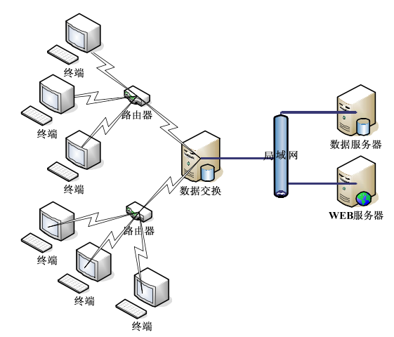
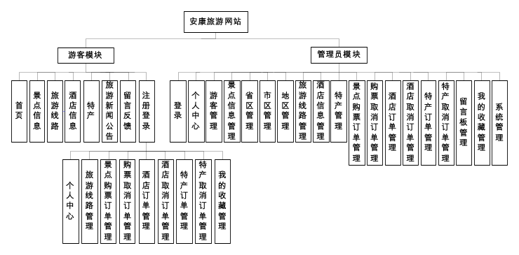
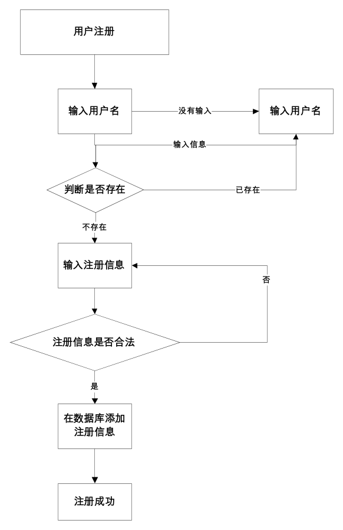
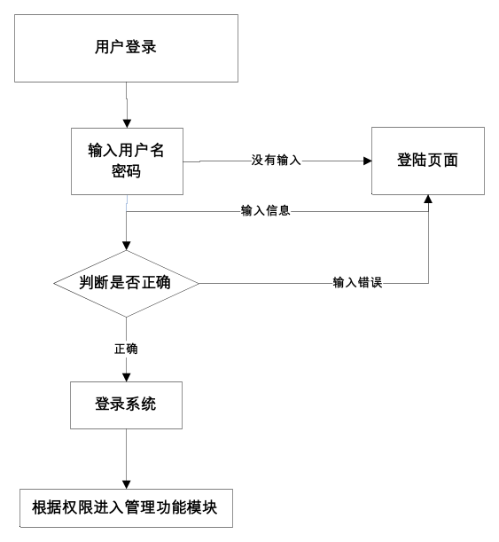
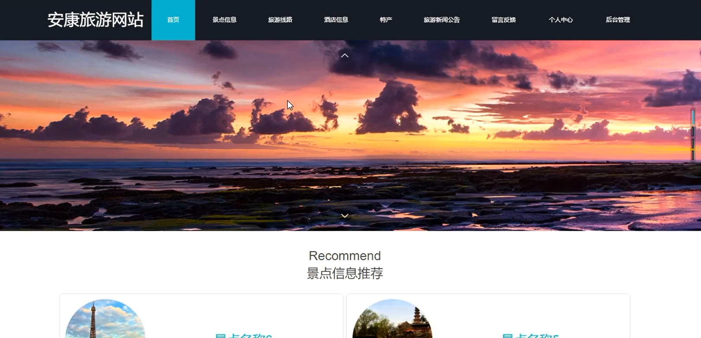
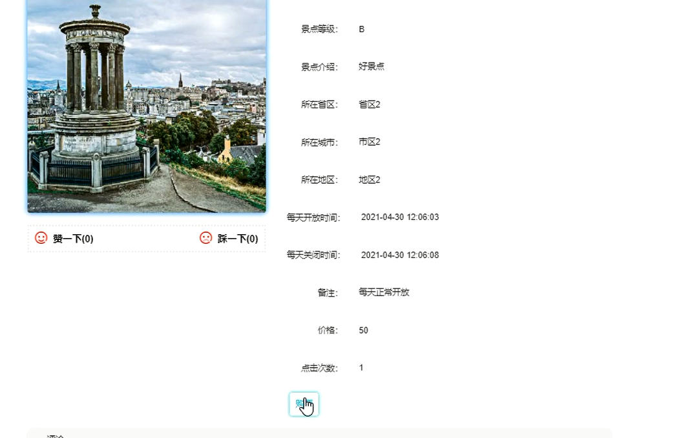
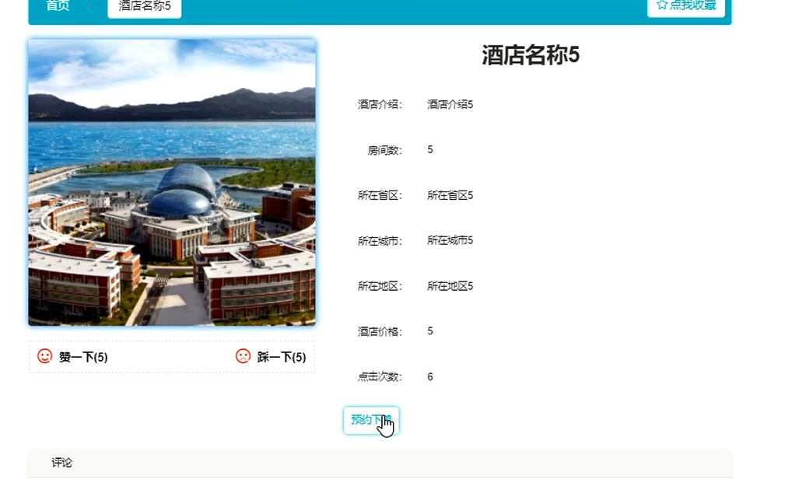
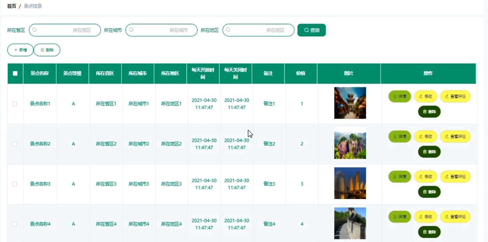
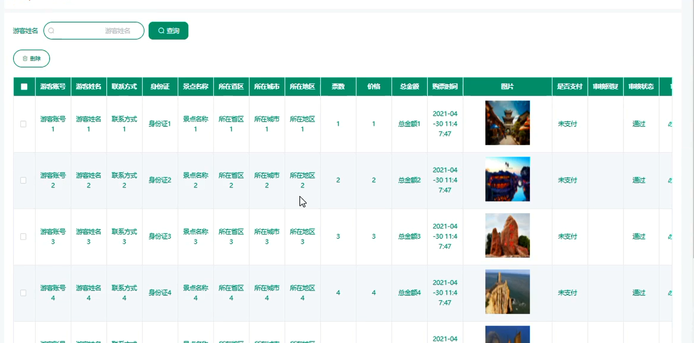
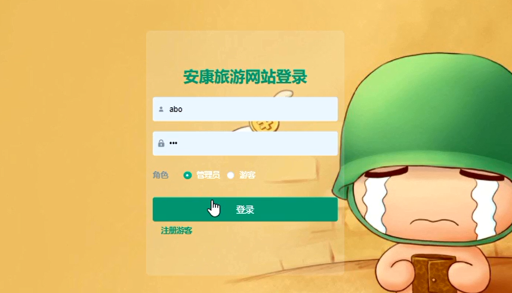

# 基于SpringBoot+Vue的安康旅游网站（源码+论文+部署）

> 针对安康本地旅游资源开发的旅游信息与在线交易平台：游客可浏览景点、旅游线路、酒店与特产，
> 注册登录后完成在线购票、酒店预订、特产下单，管理员在后台完成内容管理与订单处理。
>
> 开题与技术问题免费咨询 ｜ 随时欢迎微信联系：AfanDev

> GitHub：https://github.com/bisheWX-ayfun
> Gitee：https://gitee.com/y482248900

---

## 项目地址与资料

- GitHub 源码：https://github.com/bisheWX-ayfun/ankang-travel
- Gitee 源码（国内访问更快）：https://gitee.com/y482248900/ankang-travel
- 配套资料：完整源码 + 毕业论文（含功能结构图、流程图、系统截图）

## 一、项目介绍

随着旅游业的发展，传统的旅游信息查询方式已经难以满足用户需求。本系统针对安康旅游场景开发，
把景点、旅游线路、酒店、特产四类资源集中到一个平台上，让游客在一个站点内完成「查信息 — 下单 —
管理订单」的全过程。系统的核心理念是「操作简单，功能实用」，页面结构清晰，功能路径短，
适合作为毕业设计、课程设计或 Java Web 入门练手项目。

系统分为游客模块与管理员模块两大部分。游客可查看景点信息、旅游线路、特产信息、酒店信息，
注册登录后可进行景点购票、酒店预订、特产购买等操作；管理员进入后台，对系统内容与订单进行全面管理。

工程实现采用 SpringBoot + Vue 的前后端分离结构：后端提供数据接口并托管已打包的前台、后台页面，
数据库使用 MySQL，部署时只需启动一个 Java 工程。
（论文中页面技术表述为 JSP，实际工程前端为 Vue + Element UI，以工程为准。）

## 二、技术架构

- 后端：SpringBoot 2.2.2 + MyBatis-Plus 2.3 + Shiro 1.3.2
- 前端：Vue + Element UI + Axios（前台与后台两套页面，已打包进后端）
- 数据库：MySQL 5.7 / 8.0
- 开发环境：JDK 1.8 + IDEA + Maven 3.6+

系统采用 B/S 架构，浏览器直接访问，无需安装客户端：

## 三、功能模块

系统分为游客模块与管理员模块两大部分，功能结构如下（对应论文图 4.1）：

### 用户端功能

| 功能模块 | 功能描述 |
| --- | --- |
| 注册登录 | 游客注册、账号密码登录、登录状态校验 |
| 首页 | 轮播图展示、景点信息推荐、旅游新闻公告入口 |
| 景点信息 | 景点列表与详情查看、发表评论、收藏、在线购票 |
| 旅游线路 | 线路列表与详情查看、收藏 |
| 酒店信息 | 酒店列表与详情查看、发表评论、在线预订 |
| 特产 | 特产列表与详情查看、发表评论、在线下单 |
| 旅游新闻公告 | 资讯列表与详情浏览 |
| 留言反馈 | 提交留言、查看管理员回复 |
| 个人中心 | 修改个人资料、我的购票订单、酒店订单、特产订单、各类取消订单、我的收藏 |

### 管理端功能

| 功能模块 | 功能描述 |
| --- | --- |
| 管理员登录 | 后台独立登录入口、权限校验 |
| 游客管理 | 注册用户的查询、新增、编辑、删除 |
| 景点信息管理 | 景点发布、编辑、删除及景点评论管理 |
| 旅游线路管理 | 旅游线路的新增、编辑、删除 |
| 酒店信息管理 | 酒店信息维护及酒店评论管理 |
| 特产管理 | 特产信息维护及特产评论管理 |
| 地区管理 | 省区、市区、地区三级数据维护 |
| 订单管理 | 景点购票订单、酒店订单、特产订单的查询、审核、修改 |
| 取消订单管理 | 购票取消、酒店取消、特产取消三类订单的处理 |
| 留言板管理 | 留言查看与回复 |
| 系统管理 | 新闻公告发布、首页轮播图维护、系统配置 |

## 四、核心业务流程

以「景点购票」为例，主流程如下：

1. 游客浏览景点列表，进入景点详情页
2. 未登录的用户先注册并登录
3. 在详情页提交购票信息，生成景点购票订单
4. 管理员在后台查看并审核订单
5. 用户在个人中心查看订单状态；如需退票，可提交购票取消订单

酒店预订与特产下单的流程与之一致，均支持「下单 — 后台处理 — 用户取消」的闭环。

### 注册流程

### 登录流程

## 五、项目亮点

1. **多条业务线闭环**：景点购票、酒店预订、特产下单均支持下单、后台处理、用户取消的完整流程，不是单纯的展示站
2. **用户互动齐全**：景点、酒店、特产均带评论功能，另有收藏与留言板，适合做交互类毕设
3. **地区三级管理**：省区、市区、地区分层维护，旅游线路与景点、酒店内容相互关联
4. **前后台分离**：前台展示交易、后台管理各司其职，Shiro 负责登录鉴权，接口统一由 SpringBoot 提供
5. **论文图表齐全**：功能结构图、注册与登录流程图、登录与添加信息顺序图、实体属性图、系统截图一应俱全，写论文和答辩可直接取用

## 六、系统截图

### 前台首页

### 景点信息详情

### 酒店详情与预订

### 后台景点信息管理

### 后台购票订单管理

### 系统登录界面

## 七、部署说明

环境要求：JDK 1.8、Maven、MySQL，具体版本以工程配置为准。

大致步骤：

1. 新建数据库，导入随附的 SQL 脚本
2. 修改配置文件中的数据源账号密码，启动后端工程
3. 按项目说明文档中的地址访问前台与后台

> 前端页面已打包进后端，无需单独启动前端服务。
> 需要完整部署文档、启动报错排查或远程协助部署，加微信联系，备注项目名。

## 八、关于我

### 自我介绍

我是 AfanDev，一个专注 Java 后端与前端工程化的开发者。

这些年陆陆续续攒下不少完整可运行的毕业设计项目，与其让它们在硬盘里吃灰，不如整理出来，
分享给正在为毕设、课设发愁，或者想找项目练手的同学。每一套项目我都会尽量配齐论文、
功能结构图、流程图和真实系统截图，让你在看代码之前，就能先判断这套系统值不值得参考。

可以提供：选题与功能设计思路、开题报告框架、项目部署、代码讲解、答辩辅导等。
有具体需求加微信聊，备注项目名，我看到会回复。

### 我的主页

| 平台 | 地址 |
| --- | --- |
| GitHub | https://github.com/bisheWX-ayfun |
| Gitee | https://gitee.com/y482248900 |

### 联系我

微信号：**AfanDev**（备注「安康旅游网站」，方便我快速定位你问的是哪个项目）

- 免费咨询：开题方向、技术选型、环境报错
- 部署协助：远程部署、启动问题排查
- 学习辅导：代码逻辑讲解、答辩问题梳理

## 九、声明

- 本项目仅用于学习交流，请勿直接用于商业用途或原样提交为个人毕业设计。
- 本项目由 AfanDev 整理与维护，README 与配图说明为重新整理编写；
  原始作者信息以论文及源码内署名为准。
- 若内容涉及您的权益，请通过上述联系方式告知，我会及时处理。
